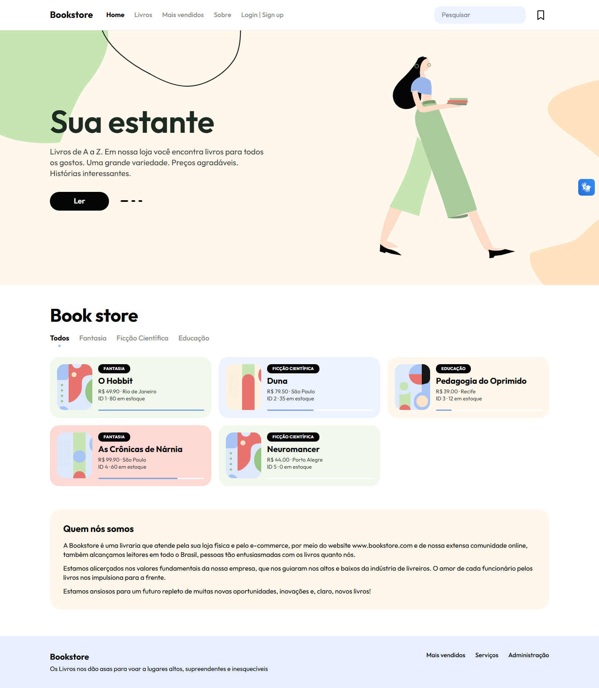
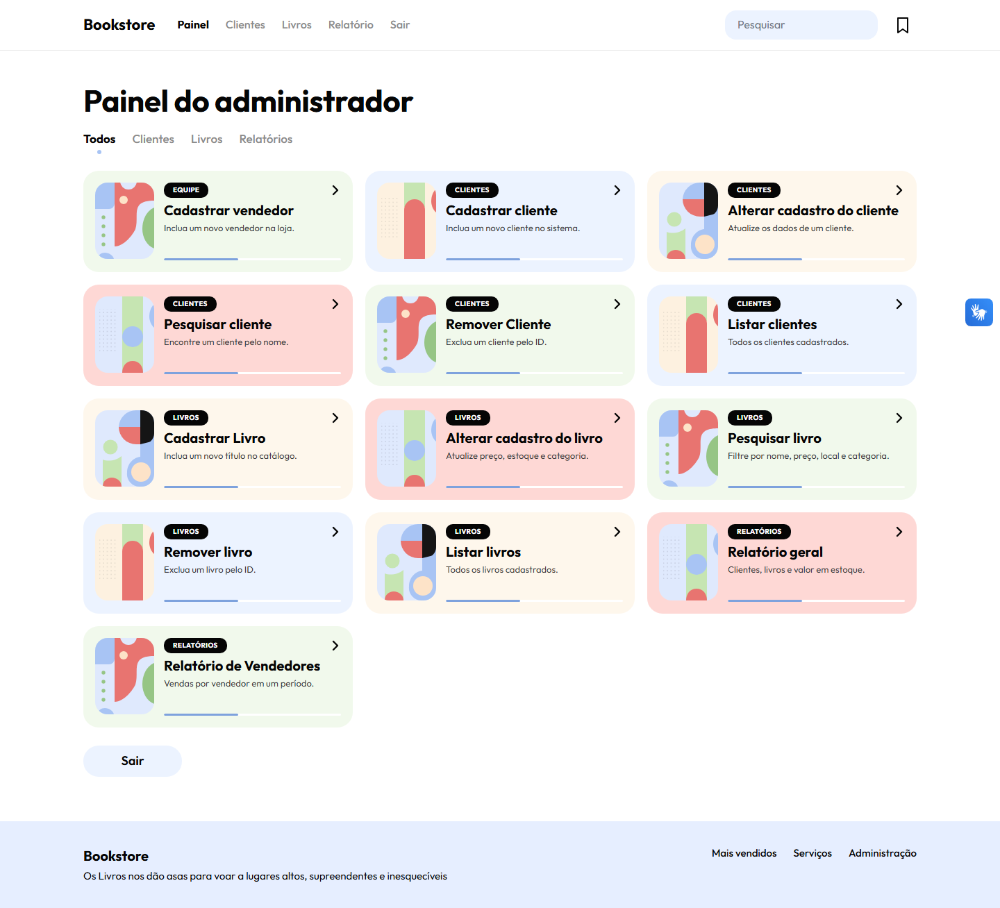
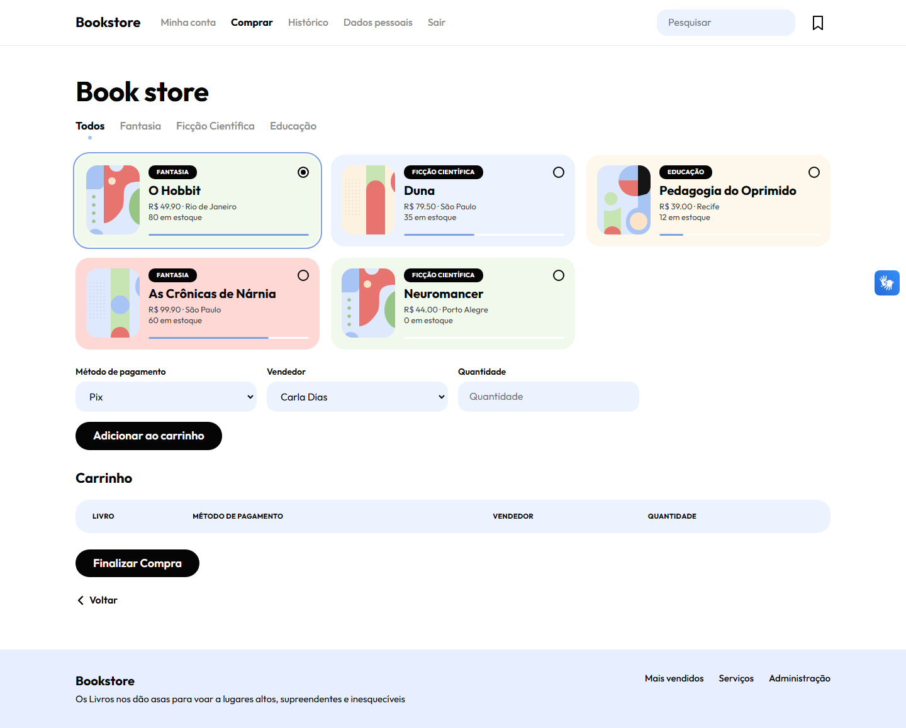

# Bookstore

Livraria web feita com **Flask** e **MySQL**, com área para clientes, vendedores e administradores. Tem catálogo com filtros, carrinho, histórico de compras e relatórios de vendas, tudo em um visual pastel que funciona no computador e no celular.



## Funcionalidades

**Visitantes**

- Catálogo na página inicial, com abas por categoria e busca
- Ranking dos livros mais vendidos
- Cadastro e login de clientes

**Clientes**

- Compra com carrinho, escolha de pagamento e vendedor
- Histórico de compras
- Edição dos dados pessoais

**Vendedores**

- Cadastro, busca e listagem de clientes
- Busca de livros por nome, preço, local, categoria e estoque
- Relatório de vendas por período

**Administradores**

- Tudo o que o vendedor faz, mais o cadastro de vendedores
- Cadastro, alteração e remoção de clientes e livros
- Relatório geral com clientes, livros, estoque e valor armazenado

## Telas

| Painel do administrador                                       | Compra                                         |
| ------------------------------------------------------------- | ---------------------------------------------- |
|  |  |


## Tecnologias

- **Back-end:** Python, Flask e `mysql-connector-python`
- **Banco de dados:** MySQL
- **Front-end:** templates Jinja2, CSS e JavaScript puros, sem framework
- **Acessibilidade:** widget [VLibras](https://vlibras.gov.br/) em todas as páginas

## Como rodar

Você vai precisar de Python 3.10 ou mais recente e do Docker.

**1. Clone o repositório**

```bash
git clone git@github.com:viviannyk/Bookstore.git
cd Bookstore
```

**2. Instale as dependências**

```bash
python -m venv .venv
.venv\Scripts\activate        # Windows
source .venv/bin/activate     # Linux e macOS
pip install flask -r data/requirements.txt
```

**3. Prepare o banco de dados**

Crie o arquivo `data/.env` a partir de `data/.env.example`, com a mesma senha configurada em [`Parte 2/app.py`](<Parte%202/app.py>). Depois, suba o MySQL e gere os dados fictícios:

```bash
docker compose -f data/docker-compose.yml up -d --wait
python data/seed/seed.py
```

O schema em [`data/sql/schema.sql`](data/sql/schema.sql) é aplicado automaticamente na primeira vez que o container sobe. O seed cria 500 clientes, 120 livros, 10 vendedores e 20 mil vendas em 2 anos. Para recomeçar do zero, rode `python data/seed/seed.py --reset`.

Para entrar como cliente, use `demo@bookstore.local` e a senha `demo123`.

**4. Inicie o servidor**

```bash
cd "Parte 2"
python app.py
```

Depois é só abrir [http://localhost:5000](http://localhost:5000). Se o MySQL estiver fora do ar, a página inicial abre mesmo assim, sem o catálogo; as demais páginas que usam o banco não funcionam.

## Estrutura

```
data/
├── docker-compose.yml     # MySQL local
├── sql/schema.sql         # Tabelas, view e procedures
└── seed/seed.py           # Dados fictícios

Parte 2/
├── app.py                 # Rotas e consultas ao banco
├── static/
│   ├── css/bookstore.css  # Tema do site
│   ├── js/                # Menu, abas, busca e máscaras
│   └── img/               # Ilustração, capas e formas em SVG
└── templates/
    ├── base.html          # Layout comum: barra do topo e rodapé
    ├── _macros.html       # Componentes: cards, abas, campos e tabelas
    ├── partials/          # Telas compartilhadas por admin e vendedor
    ├── Pages_admin/
    ├── Pages_cliente/
    └── Pages_vendedor/
```

## Licença

Distribuído sob a licença MIT. Veja o arquivo [LICENSE](LICENSE).
